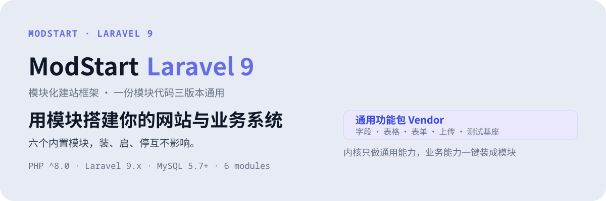
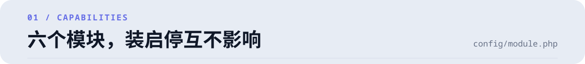
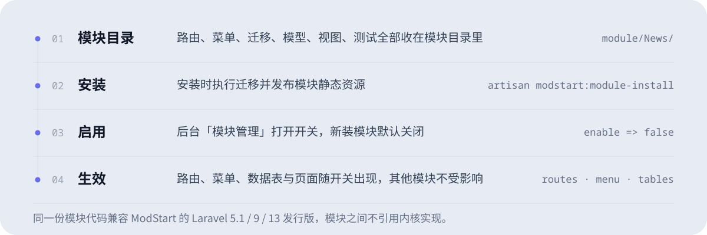
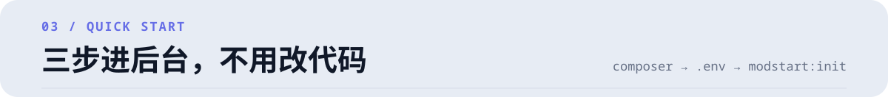
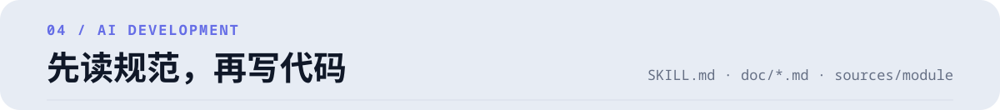

<p align="center">
  
</p>

# ModStart Laravel 9

基于 **Laravel 9** 的模块化建站框架。路由、菜单、数据表、视图都收在模块里，装、启、停互不影响。后台由 `AdminManager` 提供，装上就有；开发时接上 [AI 开发技能](#ai-开发技能)，助手先读规范再动手。

<p align="center">
  <a href="https://modstart.com" target="_blank"></a>
  <a href="https://laravel.com" target="_blank"></a>
  <a href="https://www.php.net" target="_blank"></a>
  <a href="https://www.mysql.com" target="_blank"></a>
  <a href="LICENSE" target="_blank"></a>
</p>

<p align="center">
  <a href="https://modstart.com">官网</a> ·
  <a href="https://demo-modstart-laravel9.modstart.com">前台演示</a> ·
  <a href="https://demo-modstart-laravel9.modstart.com/admin/">后台演示</a> ·
  <a href="https://modstart.com/doc">开发文档</a> ·
  <a href="#ai-开发技能">AI 开发技能</a> ·
  <a href="https://modstart.com/store">模块市场</a> ·
  <a href="https://modstart.com/forum">交流论坛</a>
</p>

前台与后台都不需要写代码就能跑起来：`modstart:init` 一条命令完成迁移、安装已启用模块、创建管理员。

> 演示站装了会员、CMS、博客等模块，跟本仓库默认的精简装配不是一回事，别拿它判断默认功能。演示数据会定期重置，后台账号以登录页提示为准。

<details>
<summary>本仓库默认装配了什么</summary>

`config/module.php` 注册 6 个核心模块：`Vendor`、`AdminManager`、`ModuleStore`、`Site`、`Nav`、`Welcome`，运行时就是这 **6 个模块**。模块开发助手 `ModuleDeveloper` 默认未启用，需要时在后台「系统管理 → 模块管理」安装。

前台首页由 `Welcome` 模块提供：它在 `Core/ModuleServiceProvider` 里向 `HomePageProvider` 注册，`app/Web/Controller/IndexController` 的默认首页动作指向 `\Module\Welcome\Web\Controller\IndexController@index`。模块目录下的代码保持 Laravel 5.1 / 9 / 13 三版本通用语法，同一份模块可以运行在 ModStart 的各发行版上。

</details>

<p align="center">
  
</p>

## 内置模块

| 模块 | 提供的能力 |
|---|---|
| `Vendor` 通用功能包 | 字段、表格、表单、文件上传、分片上传、测试基座等通用能力 |
| `AdminManager` 管理员框架 | 基于 RBAC 的权限管理，多管理员多角色，手机 / 平板 / PC 均可管理 |
| `ModuleStore` 模块市场 | 后台在线安装、卸载、升级模块 |
| `Site` 基本设置 | 站点名称、Logo、SEO、备案、主色调等配置 |
| `Nav` 通用导航 | 头部 / 底部 / 底部次导航三个展示位置 |
| `Welcome` 欢迎首页 | 介绍型首页，含后台、文档、模块市场快捷入口 |

> `ModuleDeveloper`（模块开发助手，一键创建模块、打包与发布）**默认未启用**，需要时在后台「系统管理 → 模块管理」安装。

**系统特性**

- 一份代码多版本：`module/` 里的代码同时要跑 Laravel 5.1 / 9 / 13
- 后台能力内置：RBAC、数据表格、数据表单、文件上传、操作日志都在 `AdminManager` 与 `Vendor` 里，做业务不用重写
- 内置实现优先：通用能力由基础库自己实现，不额外引第三方 PHP 依赖
- 模块市场：后台在线安装、升级，业务能力按需装，核心代码不动
- 多端适配：PC 主题、H5 页面与接口共用同一套业务逻辑

技术栈：Laravel 9 · ModStart 基础库 · Vue · Element UI · jQuery。

<p align="center">
  
</p>

## 模块如何工作

<p align="center">
  
</p>

模块自带路由、菜单、数据表与视图，生命周期只有四步：放进 `module/`、执行安装、后台启用、立刻生效。停用后这些能力整体消失，其他模块与内核都不受影响。

**首页与主题怎么换**

- **换首页**：启用 `HomePageSwitcher` 模块后在后台「首页切换器」选择；或修改 `app/Web/Controller/IndexController` 的默认首页动作；或在模块 `Core/ModuleServiceProvider` 中 `HomePageProvider::register()` 注册新的首页提供者。
- **主题模板**：`resources/views/theme/default/pc/`（`frame.blade.php` + `share/header.blade.php` + `share/footer.blade.php`）。模板用 `modstart_module_enabled('Member')`、`modstart_module_enabled('Nav')` 判断模块能力，模块未启用时自动隐藏相关区域，不会报错。
- **样式覆盖**：`public/theme/default/css/style.css` 加载在编译产物之后，用于站点级覆盖（主色调、页脚深色区域文字色等），无需重新编译。

<p align="center">
  
</p>

## 快速开始

**环境要求**

| 项目 | 要求 |
|---|---|
| PHP | `8.1.x` / `8.2.x`（`composer.json` 的 `require.php` 为 `^8.0`；8.3+ 未列入官方支持范围，本机实测 `8.1.34`） |
| MySQL | `>= 5.7`（`MariaDB 10.3+` 亦可，本项目已在 MySQL `5.7.44` 下验证） |
| PHP 扩展 | `fileinfo`、`pdo_mysql`、`mbstring`、`openssl`、`curl`、`zip`、`bcmath`、`tokenizer`、`exif`（图像处理建议再装 `gd`） |
| PHP 函数 | `proc_open`、`putenv`、`proc_get_status` 未被禁用 |
| 运行环境 | 64 位 PHP；`bootstrap/`、`bootstrap/cache/`、`storage/`、`public/` 目录可写 |
| Web 服务器 | `Nginx` / `Apache`，站点运行目录指向 `public/`，需支持 Rewrite（访问 `/install/ping` 返回 `ok`） |
| Composer | `2.x`（仅在更新 PHP 依赖时需要；`vendor/` 已随仓库提供） |
| Node.js | 仅在重新编译前端资源、运行模块截图脚本时需要 |

**命令行安装**

```bash
cp env.example .env            # 填写 DB_HOST / DB_PORT / DB_DATABASE / DB_USERNAME / DB_PASSWORD
php artisan key:generate
php artisan modstart:init --username=admin --password=123456
```

`vendor/` 已随仓库提供（含 Laravel 框架与 ModStart 基础库），**无需 `composer install`**；只有更新 PHP 依赖时才执行。

`modstart:init` 依次执行数据库迁移、安装 `config/module.php` 中已启用的模块、创建后台管理员，最后写入 `storage/install.lock`；追加 `--demo` 可同时导入演示数据。`make PublishAsset` 会清掉 `public/asset` 与 `public/vendor`，再（以 `php81`）执行迁移、`vendor:publish` 与 `modstart:module-install-all`，用于重新发布静态资源。

> 版本门槛以安装向导的环境检查为准：PHP `8.1.x` / `8.2.x`（`composer.json` 约束为 `^8.0`，8.3+ 未列入官方支持范围）。本文档命令统一使用 `php`，验证环境为 PHP `8.1.34`。
>
> MySQL 注意：Linux 下 MySQL 走 socket 报 `No such file or directory` 时，把 `.env` 的 `DB_HOST` 改为 `127.0.0.1`。静态资源不同步时执行 `php artisan vendor:publish --provider="ModStart\ModStartServiceProvider"` 重新发布 `public/asset`。仓库中的环境变量模板文件名是 `env.example`（不是 `.env.example`）。

<details>
<summary>安装向导（浏览器安装）</summary>

部署代码后访问 `http://your-domain/install.php`（`vendor/` 已随仓库提供，无需 `composer install`）。向导共三步（安装协议 → 环境检查 → 配置安装），页面在 `public/install.php`，逻辑在 `module/Vendor/Installer/install.php`，接口为 `module/Vendor/Web/routes.php` 中的 `install/ping`、`install/prepare`、`install/execute`、`install/lock`：

1. **安装协议**：`license_url.txt` 中的协议地址（`https://modstart.com/article/license`），同意后才能继续；
2. **环境检查**：PHP 版本（`8.1.x` / `8.2.x`）、扩展与函数、目录可写、Rewrite 规则（`/install/ping` 返回 `ok` 才算通过）与 `.env` 可写性；
3. **配置安装**：填写 MySQL 连接与后台管理员账号 → `/install/prepare` 校验数据库连接并按 `env.example` 生成 `.env` → `/install/execute` 执行 `migrate`、创建管理员、逐个安装模块，最后写入 `storage/install.lock`。

注意：

- 站点运行目录必须指向 `public/`（页面提示「安装路径为 public/install.php」即说明根目录配置有误）；
- 需要重装时必须先删除 `storage/install.lock`，并清空 `.env` 中的 `DB_HOST` 等连接信息（`prepare` 会拒绝已有数据库配置的 `.env`，提示「请先清空 .env 文件」）；
- 向导从 `env.example` 生成 `.env`，其中 `APP_KEY`、`ENCRYPT_KEY` 由安装器随机生成，其余固定项原样保留；
- 后台入口由 `.env` 的 `ADMIN_PATH` 控制，默认 `/admin/`；
- 安装完成后建议删除 `public/install.php`（保留也可，向导会提示「系统无需重复安装」）。

</details>

<details>
<summary>目录结构</summary>

```
app/                      项目应用层（Admin / Web / Api / Exceptions / Providers）
app/Web/routes.php        应用前台路由（含首页），与模块路由一起由 ModStartServiceProvider 注册
app/Web/Controller/       前台控制器（首页入口 IndexController 指向 Welcome 模块）
app/Admin/Controller/     后台控制器（首页 Dashboard 依赖 AdminManager）
config/app.php            应用配置，在 providers 中注册 \ModStart\ModStartServiceProvider
config/module.php         系统模块注册表（默认注册 6 个核心模块）
database/migrations/      ModStart 核心表迁移
module/                   模块目录
module/Welcome/           欢迎首页模块（介绍页 + 首页提供者 + 后台首页信息卡片 + 截图脚本）
public/asset              基础库静态资源（vendor:publish --tag=modstart 发布）
public/vendor             模块静态资源（模块安装时发布）
public/theme/             站点级静态资源（theme/default/css/style.css 覆盖主题样式）
resources/views/errors/   错误页（ErrorPage 模块未启用时使用 ModStart 默认样式）
resources/views/theme/    前台默认主题（header / footer 按 modstart_module_enabled() 与模块解耦）
vendor/modstart/modstart  ModStart 基础库（随仓库提供，非 Composer 托管）
env.example               环境变量模板（文件名是 env.example，不是 .env.example）
```

> 前台路由不使用 Laravel 默认的 `routes/web.php`：`app/Web/routes.php` 与各启用模块的 `Web/routes.php` 由 `ModStartServiceProvider`（`ModStartWeb::registerModuleRoutes`）统一注册。

</details>

<p align="center">
  
</p>

## AI 开发技能

模块开发的约定不少：路由放 `Api/routes.php`（不放 `Core/ModuleServiceProvider`），迁移类名要和文件名一致，`down()` 留空，Blade 里 SUI 的 `ub-` 不能和 `tw-` 混用，改了接口要补测试。人记不全，AI 没有约束时会自己发明一套。

这些约定连同示例代码打成了一个技能包，交给助手读：

**[https://github.com/modstart-lib/modstart-skill](https://github.com/modstart-lib/modstart-skill)**（Apache-2.0）

| 路径 | 内容 |
|---|---|
| `SKILL.md` | 技能入口：核心理念（示例驱动开发、约定优于配置、简单优先）、开发流程、`seed-test` 约定与文档索引 |
| `doc/module.md` | 模块目录结构、`Api` / `OpenApi` 路由注册与中间件、模块安装步骤 |
| `doc/basic.md`、`doc/php.md`、`doc/blade.md`、`doc/vue_js.md` | 基础 / PHP / Blade（SUI 与 `tw-` 不混用、`@asset()`、禁止大段 `@php`）/ Vue & JavaScript |
| `sources/module/` | 示例模块源码：`Demo`（表格、表单、Widget、任务）、`CmsThemeDemo`、`BlogThemeDemo` |

**第一步：让助手装技能**

不用自己克隆、翻配置，直接把这句话丢给助手：

```text
把 https://github.com/modstart-lib/modstart-skill 安装为技能
```

**第二步：直接提需求**

装好之后不用再重复规范，按功能描述即可：

```text
按 modstart-skill 的规范开发「新闻管理」功能：
1. 模块名 News，后台 CRUD：title（标题）、cover（封面）、content（内容）；
2. 列表按标题模糊搜索，创建时间倒序；
3. 同时给出接口测试脚本，并列出需要我执行的 artisan 命令。
```

把 `News`、字段与筛选条件换成你要的即可；写清「哪个模块、哪几个字段、列表怎么筛」，助手就能对着 `sources/module/` 的同类实现写出符合约定的代码。

**落到具体任务上**

- 新增后台 CRUD：字段、`gridFilter`、`HasAdminQuickCRUD` 按仓库现有写法生成
- 新增接口：同时给出 `Test/Api/*.php` 测试脚本，符合「接口改动必须补测试」的约定
- 改后台视图：用 SUI 类而不混 `tw-` 类，静态资源走 `@asset()`，不在模板里堆 `@php`
- 建模块：按 `Admin` / `Web` / `Api` / `Migrate` / `Model` / `View` 的目录约定落代码，最后给出 `modstart:module-install` 命令

> 技能包是索引与约束，不是事实来源：规范与本仓库 `module/` 下的实现冲突时，以仓库代码为准。

<p align="center">
  
</p>

## 写一个模块

下面以「新闻管理」为例走一遍；接上 AI 开发技能后，这八步可以直接让助手按同一套约定出初稿，再由你按业务改。

**① 模块目录**

```
module/News/
├── Admin/
│   ├── Controller/NewsController.php
│   └── routes.php
├── Core/ModuleServiceProvider.php
├── Migrate/
├── Model/News.php
├── View/pc/
├── Test/
├── Docs/release.md
├── config.json
└── README.md
```

> 模块生命周期内需同步维护 `README.md` 与 `Docs/release.md`（更新记录）。

**② 模块声明 `config.json`**

```json
{
  "name": "News",
  "title": "新闻管理",
  "version": "1.0.0",
  "author": "官方",
  "env": ["laravel5", "laravel9", "laravel13"],
  "require": ["Vendor:>=3.0.0"],
  "suggest": [],
  "modstartVersion": ">=6.0.0",
  "description": "新闻管理示例模块",
  "providers": [],
  "config": {}
}
```

**③ 数据表迁移 `Migrate/2026_11_03_000000_news_create.php`**

```php
use Illuminate\Database\Schema\Blueprint;
use Illuminate\Database\Migrations\Migration;

class NewsCreate extends Migration
{
    public function up()
    {
        Schema::create('news', function (Blueprint $table) {
            $table->bigIncrements('id');
            $table->timestamps();
            $table->string('title', 200)->nullable()->comment('标题');
            $table->string('cover', 200)->nullable()->comment('封面');
            $table->text('content')->nullable()->comment('内容');
        });
    }

    public function down()
    {
        //
    }
}
```

> 无需 `hasTable` 守卫（重复执行由 `migrations` 表兜底）；类名必须等于文件名去掉日期序号的 StudlyCase（`news_create.php` → `NewsCreate`）；字段一律 `nullable()`，`down()` 留空。

**④ 模型 `Model/News.php`**

```php
namespace Module\News\Model;

use Illuminate\Database\Eloquent\Model;

class News extends Model
{
    protected $table = 'news';
}
```

**⑤ 控制器 `Admin/Controller/NewsController.php`**

```php
namespace Module\News\Admin\Controller;

use Illuminate\Routing\Controller;
use ModStart\Admin\Concern\HasAdminQuickCRUD;
use ModStart\Admin\Layout\AdminCRUDBuilder;
use ModStart\Grid\GridFilter;
use ModStart\Support\Concern\HasFields;
use Module\News\Model\News;

class NewsController extends Controller
{
    use HasAdminQuickCRUD;

    protected function crud(AdminCRUDBuilder $builder)
    {
        $builder
            ->init(News::class)
            ->field(function ($builder) {
                /** @var HasFields $builder */
                $builder->id('id', 'ID');
                $builder->text('title', '标题');
                $builder->image('cover', '封面');
                $builder->richHtml('content', '内容');
                $builder->display('created_at', '创建时间');
                $builder->display('updated_at', '更新时间');
            })
            ->gridFilter(function (GridFilter $filter) {
                $filter->eq('id', 'ID');
                $filter->like('title', '标题');
            })
            ->title('新闻管理');
    }
}
```

**⑥ 路由 `Admin/routes.php`**

```php
/* @var \Illuminate\Routing\Router $router */
$router->match(['get', 'post'], 'news', 'NewsController@index');
$router->match(['get', 'post'], 'news/add', 'NewsController@add');
$router->match(['get', 'post'], 'news/edit', 'NewsController@edit');
$router->match(['post'], 'news/delete', 'NewsController@delete');
$router->match(['get'], 'news/show', 'NewsController@show');
```

**⑦ 后台菜单 `Core/ModuleServiceProvider.php`**

```php
namespace Module\News\Core;

use Illuminate\Support\ServiceProvider;
use ModStart\Admin\Config\AdminMenu;

class ModuleServiceProvider extends ServiceProvider
{
    public function boot()
    {
        AdminMenu::register(function () {
            return [
                [
                    'title' => '新闻管理',
                    'icon' => 'description',
                    'sort' => 200,
                    'url' => '\Module\News\Admin\Controller\NewsController@index',
                ]
            ];
        });
    }

    public function register()
    {
    }
}
```

**⑧ 安装并启用**

```bash
php artisan modstart:module-install News
```

新安装的模块默认 `enable => false`，在后台「模块管理」里启用即可；如需固定为系统模块，在 `config/module.php` 的 `system` 段注册：

```php
'News' => [
    'enable' => true,
],
```

> 新增模块无需修改 `.gitignore`（当前没有 `module/` 的忽略规则；若日后添加 `/module/*` 之类规则，需要补 `!/module/News/`）。

## 常用命令

| 命令 | 说明 |
|---|---|
| `php artisan modstart:module-list` | 列出已安装 / 已启用模块 |
| `php artisan modstart:module-enable <Module>` | 启用模块 |
| `php artisan modstart:module-disable <Module>` | 禁用模块 |
| `php artisan modstart:module-install <Module> [--force]` | 安装模块（迁移 + 发布资源） |
| `php artisan modstart:module-install-all` | 按依赖顺序安装所有已启用模块 |
| `php artisan modstart:module-refresh-all` | 刷新模块缓存（启停模块后执行） |
| `php artisan modstart:init [--username --password --demo]` | 初始化：迁移 + 安装模块 + 建管理员 |
| `php artisan optimize:clear` | 清理配置 / 路由 / 视图 / 应用缓存 |

## 贡献与交流

- `GitHub` [https://github.com/open-tecmz/modstart-laravel9](https://github.com/open-tecmz/modstart-laravel9)
- `Gitee` [https://gitee.com/open-tecmz/modstart-laravel9](https://gitee.com/open-tecmz/modstart-laravel9)
- 官方论坛 [https://modstart.com/forum](https://modstart.com/forum)

> 添加好友请备注 ModStart Laravel 9

<table width="100%">
    <thead>
        <tr>
            <th width="50%">微信交流群</th>
            <th>QQ交流群</th>
        </tr>
    </thead>
    <tbody>
        <tr>
            <td>
                
            </td>
            <td>
                
            </td>
        </tr>
    </tbody>
</table>

## 许可证

Apache License 2.0，详见 [LICENSE](LICENSE)。本软件基于 Apache 2.0 协议开源，支持免费商用，使用时请保留版权信息。
